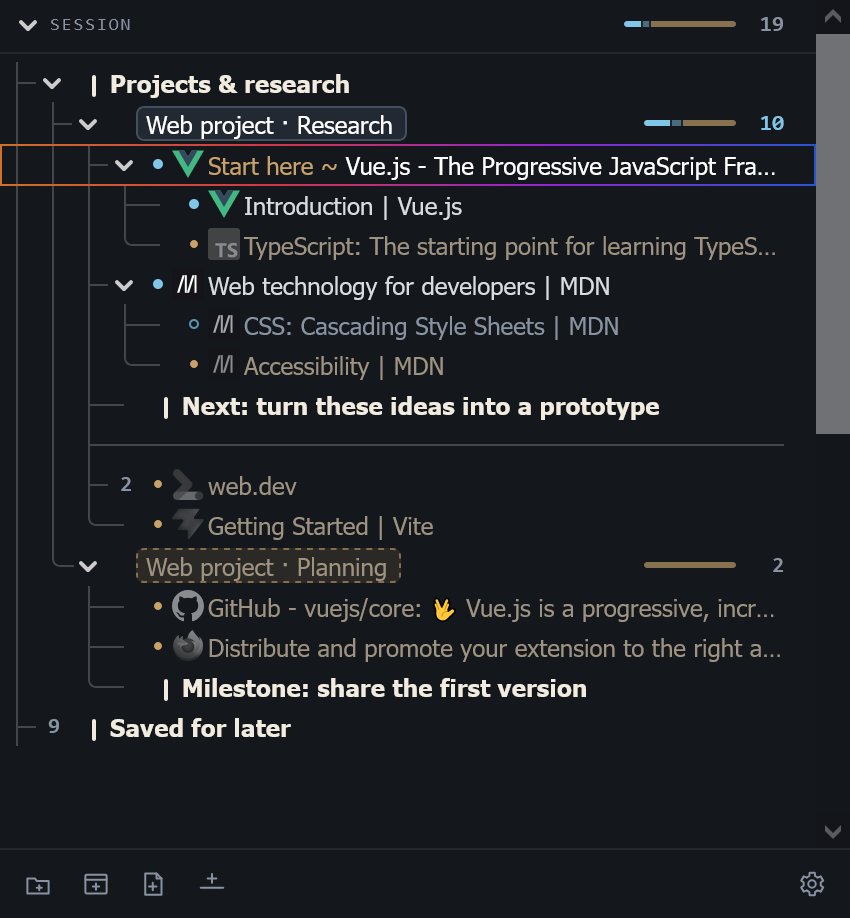
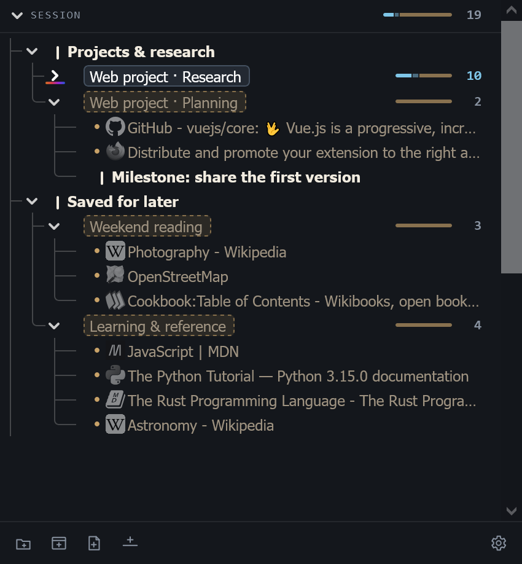
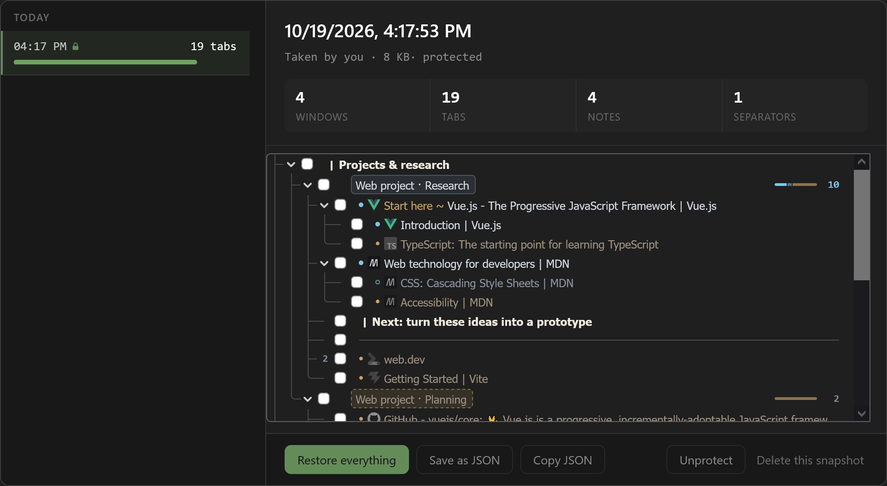

<h1 align="center">
  
</h1>

**Your Firefox windows and tabs, organized in one tree.**

Session Flow is a free, open-source Firefox extension that brings your open tabs and saved sessions together in a dedicated window. Nest related pages, group windows under notes, and set work aside without keeping every tab open.

## Features

- **A tree for your browsing.** Arrange windows, tabs, notes, and separators into collapsible branches. Drag items to reorder them or nest them under another item, and select multiple items to manage them together.
- **Keep tabs for later.** Save a tab or an entire window to close it in Firefox while keeping its place in the tree. Reopen it when you need it.
- **Notes and labels.** Add context beside your tabs, give windows meaningful names, and use notes to group windows by project or topic.
- **Session snapshots.** Take snapshots manually or on a schedule. Preview an earlier session and restore everything or just selected items.
- **Import and export.** Export snapshots as JSON, or import supported JSON exports from other session managers.
- **Firefox containers and tab groups.** See container identities and tab-group colors alongside your tree. Choose or create containers for tabs. Firefox group membership and tree nesting are independent.
- **Keyboard controls and settings.** Navigate the tree with the keyboard and customize shortcuts, drag-and-drop behavior, actions on child items, and startup behavior.

<table align="center">
  <tr>
    <td align="center" width="50%">
      <a href="docs/assets/session-tree.png">
        
      </a>
      <br />
      <em>Keep your active research organized.</em>
    </td>
    <td align="center" width="50%">
      <a href="docs/assets/session-tree-saved.png">
        
      </a>
      <br />
      <em>Set work and reading aside for later.</em>
    </td>
  </tr>
</table>

<p align="center">
  <a href="docs/assets/session-snapshots.png">
    
  </a>
  <br />
  <em>Preview a snapshot, restore your session, or export a backup.</em>
</p>

## Installation

<p align="center">
  <a href="https://addons.mozilla.org/firefox/addon/session-flow/">
    
  </a>
</p>

Requires **Firefox 140 or later**.

Install Session Flow from [Firefox Add-ons](https://addons.mozilla.org/en-GB/firefox/addon/session-flow/). Firefox keeps it up to date automatically.

You can also install a Mozilla-signed build from [GitHub Releases](https://github.com/PaxIgnis/SessionFlow/releases):

1. Open the latest release and download the `.xpi` file from **Assets**. The **Source code** archives are for development and cannot be installed directly.
2. In Firefox, open `about:addons`, click the gear menu, and choose **Install Add-on From File…**.
3. Select the downloaded `.xpi` file and confirm the installation and requested permissions.

Release `.xpi` files are the same signed builds published on Firefox Add-ons, so Firefox updates them automatically too. You can also [run Session Flow from source](#development).

Changes in each version are listed in the [release notes](https://github.com/PaxIgnis/SessionFlow/releases).

## Getting started

1. Browse the onboarding guide that opens after installation to learn about this extension.
2. Click the **Session Flow** toolbar button or press **F2** to open the tree. Your current windows and tabs appear automatically. If the button is hidden, open Firefox's Extensions panel and pin Session Flow to the toolbar.
3. Double-click an open tab to focus it, or a saved tab to reopen it. These are the default actions and can be changed in settings.
4. Drag an item onto the middle of another item to nest it beneath that item. Drop above or below to place it alongside the other item. Collapse branches to keep related pages together.
5. Use **Save** on a tab or window row to close it while keeping it in the tree. Use **Delete** to remove it from the tree and close it if it is open.
6. Open **Settings → Storage** to review snapshots, restore items, or export a backup.

Tabs have three states:

| State        | What it means                                                         |
| ------------ | --------------------------------------------------------------------- |
| **Live**     | Open in Firefox with its page loaded.                                 |
| **Unloaded** | Still open in Firefox, with its page unloaded to reduce memory usage. |
| **Saved**    | Kept in the tree and closed in Firefox until you reopen it.           |

By default, **Ctrl+F2** opens settings and **Ctrl+Alt+S** takes a snapshot. Customize these and tree actions in **Settings → Keyboard shortcuts**. Browser or operating system shortcuts may take priority.

## Compatibility with other extensions

Session Flow listens for Firefox tab and window events and opens, closes, moves, and restores tabs and windows to manage your session tree. Other extensions that automatically manage tabs, windows, or sessions can react to the same events and make conflicting changes, causing unexpected behavior.

**Disable other add-ons that automatically manage or restore tabs and windows while using Session Flow.** This includes other session managers and tools that automatically move, close, or unload tabs. If you encounter unexpected behavior, check whether it still happens with these add-ons disabled before starting a discussion.

## Snapshots and backups

Automatic snapshots are enabled by default. In **Settings → Storage**, you can change the schedule, take a snapshot immediately, preview its contents, and restore selected items or the whole tree.

Use **Save as JSON** in a snapshot preview to keep a backup outside your Firefox profile. Local snapshots do not provide a backup if the profile itself is lost or removed. There is no built-in cloud sync.

To move from another session manager, choose **Import snapshot**. Importing creates a snapshot for review before you restore anything; it does not immediately open tabs or change your current tree. Supported formats and conversion limits are covered in the [import and export guide](docs/importing-snapshots.md).

## Privacy and permissions

Session Flow has no analytics or tracking and does not send your browsing data to its developer. Your session tree, settings, and snapshots are stored locally in your Firefox profile.

Website icons may be fetched from the sites that provide them. Fetching missing icons and refreshing cached icons require optional website access. These requests can contact websites and their icon hosts.

Session Flow requests permissions for the features it provides:

| Permission                    | Purpose                                                    |
| ----------------------------- | ---------------------------------------------------------- |
| Tabs and sessions             | Track, organize, and restore browser windows and tabs.     |
| Containers and cookies        | Read and manage Firefox container identities for tabs.     |
| Tab groups                    | Read and manage Firefox tab-group membership and metadata. |
| Menus                         | Provide context-menu actions for tree items.               |
| Storage and unlimited storage | Keep your saved tree, settings, and favicon cache locally. |
| Alarms                        | Schedule automatic snapshots and maintenance.              |
| Website access (optional)     | Fetch missing favicons or refresh cached icons.            |
| Clipboard access (optional)   | Copy snapshot JSON to the clipboard when you request it.   |

Private-window access is optional and must be allowed in Firefox. Keeping private windows in the saved tree, including them in snapshots, and caching their favicons are separate settings, all off by default. Enabling them can retain private titles, URLs, or icons after private windows close. Turning retention off does not delete existing snapshots.

## Development

Session Flow is built with **WXT, Vue 3, and TypeScript**. Install Node.js and pnpm, then run:

```sh
git clone https://github.com/PaxIgnis/SessionFlow.git
cd SessionFlow
pnpm install
pnpm run dev
```

Useful commands:

| Command             | Purpose                                                |
| ------------------- | ------------------------------------------------------ |
| `pnpm test`         | Run unit, integration, regression, and property tests. |
| `pnpm run compile`  | Check TypeScript and Vue types.                        |
| `pnpm run test:e2e` | Build and run Firefox end-to-end tests.                |
| `pnpm run build`    | Build the Firefox extension.                           |
| `pnpm run zip`      | Create Firefox extension and source archives.          |

Build output is written to `.output/`. See the [E2E testing guide](tests/e2e/README.md) for browser-test setup and the [localization guide](docs/localization.md) for translations.

## Feedback and contributions

Start in [GitHub Discussions](https://github.com/PaxIgnis/SessionFlow/discussions) for questions, bug reports, feature ideas, and proposed contributions. Search existing discussions first, then start a new discussion if your topic has not been covered.

Please open an issue only after a maintainer has given you permission to do so. When opening an approved issue, link to the original discussion so the context stays together.

For bug reports, include your Firefox and Session Flow versions, the steps to reproduce the problem, and what you expected to happen. Remove private URLs and other sensitive details from screenshots or session exports before sharing them.

Code, documentation, and translation contributions are welcome. Run `pnpm test:all` and `pnpm run compile` before submitting code changes.

## License

[MIT](LICENSE) © PaxIgnis.
